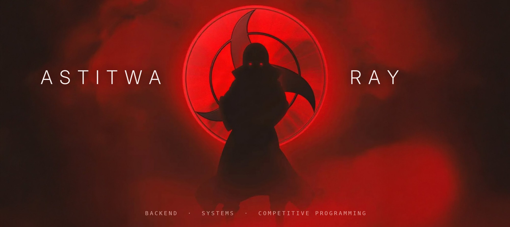

  

<h2 align="center">Hi 👋, I'm Astitwa Kumar Ray</h2>

  <b>Backend Developer · Competitive Programmer · CSE @ NIT Silchar</b>

  

  
  
  

---

### 👨‍💻 About me

I'm a final-year Computer Science student at **NIT Silchar** who enjoys turning everyday problems into **reliable, well-built software**. I work mostly on the **backend**: APIs, databases and real-time systems, and I care about clean architecture and code that holds up under real use.

Outside of projects, I solve algorithm problems for fun, with **1000+ DSA and competitive programming problems** solved so far.

  
  
  
  

---

### 🚀 Currently building

| Project | What it does | |
|---|---|---|
| 🏥 **ClinicQ** | Lets patients join a clinic queue from their phone and watch their turn update live. | [Live](https://clinicq-84sn.onrender.com) · [Code](https://github.com/astitwaroy/clinicq) |
| 🎓 **ScholarBuddy** | An AI assistant that helps students find scholarships they qualify for, with answers cited from official guidelines. | [Live](https://scholarsathi.onrender.com) · [Code](https://github.com/astitwaroy/ScholarBuddy) |
| 🦾 **ServoLab** | A robot-arm simulation that tracks a moving target in real time, right in your browser. | [Live](https://astitwaroy.github.io/Visual-servoing-2D-arm-simulation/) · [Code](https://github.com/astitwaroy/Visual-servoing-2D-arm-simulation) |

---

### 🧠 Interest areas

  
  
  
   
  
  
  

---

### 🛠️ Tech stack

  
  
  
  
  
   
  
  
  
  

### 🧰 Languages & tools I've worked with

  
    
  

---

### 📊 Analytics

  

  
  

  
  

  

### 🐍 Contribution snake

  <picture>
    <source media="(prefers-color-scheme: dark)" srcset="https://raw.githubusercontent.com/astitwaroy/astitwaroy/output/github-snake-dark.svg" />
    <source media="(prefers-color-scheme: light)" srcset="https://raw.githubusercontent.com/astitwaroy/astitwaroy/output/github-snake.svg" />
    
  </picture>

---

  <i>"First, solve the problem. Then, write the code."</i> 
  — John Johnson

  Open to internships, full-time roles and backend collaborations. Reach me on <a href="https://www.linkedin.com/in/astitwa-kumar-ray-8a7656291/">LinkedIn</a>.

